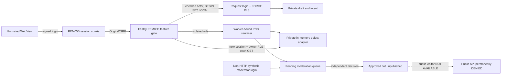

# LUEMI 💜 — REM-05D Private Profiles, Media, RLS and Moderation Verification

**Date:** 2026-10-23  
**Accepted immutable REM-05C parent:** `fb609a9d8ee5023a66f2990d4f9adb247fbd6dd7`  
**Branch:** `remediation/rem-05d-private-media-rls-moderation-20261023`  
**Draft PR:** https://github.com/zhirayr2505/luemi/pull/54 — OPEN / DRAFT / UNMERGED, base REM-05C branch.  
**Final tested SHA:** see exact head and completed GitHub Actions matrix in the PR; this report is itself part of the final candidate and must not predeclare its own self-referential commit hash.
**Gate:** **PARTIAL / NOT PRODUCTION READY**. New server features OFF in all existing deployments. No merge, deploy, live migration or real Storage access.

## 1. What is implemented — and what is not

Added `infra/migrations/0004_rem05d_private_media_moderation.sql` after accepted `0002`/`0003`; `apps/api/src/rem05d-private.ts` guarded versioned routes and transaction-bound role verification; `rem05d-image.ts` bounded PNG decode/re-encode; `apps/api/secure-tests/rem05d.test.ts` executable PostgreSQL 16 negative tests; `rem05d-focused.yml` new two-job isolated/server and preservation suite. `app.ts` and `config.ts` wire tests only; previous 05B/C Actions triggers now include the 05D branch and PR base.

- **Private drafts:** server UUID authenticated via REM-05B opaque cookie, verified Origin+CSRF for PUT, strict field allowlist, 8 KB DB check, 7 KB application payload bound, revision/CAS including concurrent 409 and no remote update for another actor. Source of authority is REM-05B verified `authActor`, NEVER `ownerId`, `X-Actor-Id` or client-local unsigned Telegram scope.
- **Publication:** independent `public_profiles` schema projection has `CHECK(publication_status='draft')` and `CHECK(published_revision=0)`; no public SELECT policy, public GET 404, submit 403. Approved media is still private. No future Stage04/Bliki/chat/payments changes.
- **Media:** per-actor SQL transaction advisory lock + 6-slot cap for all non-revoked assets, server UUID and random opaque internal path, one-hour synthetic intent expiry, digest-bound idempotency; a bounded proxy ingestion path enforces exact expected byte count, PNG signature/chunks/CRC, pixel count <=4,000,000, side <=2048, input/derivative <=1 MiB. A native 50MP header is rejected before allocation. Supported test format is **PNG RGB/RGBA 8-bit, non-interlaced only**; JPEG, HEIC, AVIF, video and unknown critical chunks FAIL CLOSED. The decode/re-encode drops EXIF/XMP/ICC and ancillary fields rather than accepting byte headers as safety proof. A reliable cross-format production scanner, worker sandbox and malware analysis **are NOT implemented**.
- **Storage:** a **process-local, private in-memory adapter (MOCK)** is explicitly passed by test-only config; no Supabase SDK, bucket, signed URL or service key is touched. Object bytes never returned by intent/preview DTO. Image upload results in `pending_review`; derivative GET only after a separate synthetic moderator decision, and only for current owner/session at each GET; `private,no-store` and MIME-safe headers. Storage is non-durable by design: a restart fails closed with `media_unavailable`, not false success.
- **Moderation:** separate role-backed, non-HTTP `syntheticModerate` helper only in isolated QA, append-only decision + minimal audit, state `pending_review -> approved/rejected`; no automatic moderation approval, remote staff/operator login, scanner integration, appeals or public moderation dashboard. Reports have reason allowlist, RLS isolation and client-key dedup; blocks have structural same-environment FK and own-only RLS. No public discovery is enabled, so real two-way visibility of public media remains **NOT TESTED**.
- **Safety:** DOB field is optional for partial draft but invalid dates / reported age <18 and unknown consent version are rejected when submitted. This is **self-declared age**, not age verification; exact local/legal policy, consent language, retention and automated child-protection procedures remain OWNER DECISION REQUIRED.

### Internal dataflow / trust boundary

The session issuer never becomes the request role. Worker and moderator must have separate login-role memberships, no inherited request/issuer/geo powers and no BYPASSRLS. A custom GUC is trusted only because server code sets it from REM-05B session on a checked-out transaction; it is **not** cryptographic authentication if SQL/Data API is exposed to arbitrary clients.

## 2. Schema/roles, field-level privacy and deployment scope

`private_profile_drafts`: owner UUID + bot namespace composite FK, revision, bounded typed JSON, private DOB/consent; `public_profiles`: allowlisted fields but hard-draft-only; `media_assets`: server key, opaque asset UUID, private state/version/position/content digest/dimensions; `media_uploads`: actor, asset, size, MIME, expiry, idempotency digest; `moderation_jobs`/append-only `moderation_decisions`; actor-local `blocks`, `reports`, append-only `audit_events`.

All nine tenant-bearing additions have `ENABLE` **and** `FORCE ROW LEVEL SECURITY`. Request-role policies bind both `luemi.actor_id` and `luemi.environment` via transaction-local GUC, with `USING`/`WITH CHECK`. Permissions on owner/moderation/status columns are narrower than table-level RLS. No public RPC / SECURITY DEFINER / public Storage URL is introduced. `anon`, `authenticated`, and PUBLIC lose all new-table permissions. No private schema is added to any PostgREST exposed-schema config. **The actual Supabase Data API exposed-schema setting is not verified.**

The current request login may read its own private media internal path under DB RLS for the trusted gateway; no such key enters an HTTP JSON response, Storage public URL or browser cache. Restricted reviewer gets metadata but not `original_key`/`derivative_key`. The worker may process/upload but cannot inspect private drafts or sessions. Deployment must use distinct vault-managed credentials and non-public buckets; **no such resources have been provisioned**.

### Synthetic `/api/v2` contracts

| HTTP | Purpose | Security/result |
|---|---|---|
| GET /profile/draft | owner-only current version | `{state:'empty',revision:0,fields:{}}` or private fields |
| PUT /profile/draft | allowlisted replace + revision CAS | 200 + revision, stale 409, invalid 422, bad auth 401/403 |
| GET /profile/preview | owner-only safe projection and media status | no DOB, storage paths or entitlements |
| GET /profile/public/:id | real account public projection | ALWAYS 404 in REM-05D |
| POST /profile/submit | synthetic/publication control | ALWAYS 403 `publication_disabled` |
| POST /media/intents | serialized 6-slot reservation, retry digest | opaque asset ID only; conflicts 409 |
| PUT /media/:id/bytes | exact intent + sanitized PNG into private test storage | pending_review only, 422 invalid, 404 foreign |
| GET /media/:id | re-authorized owner approved clean bytes | 200 image/png private no-store; 404 hidden/pending/revoked |
| GET/POST/DELETE /profile/blocks | own blocks | no cross-owner row read |
| GET/POST /profile/reports | own reports and deduplicated opaque case | no foreign evidence |

A 503 denotes offline/missing limited DB or private storage, not a fabricated remote save. No `public_publish=true`, signed URLs, service-role fallback or real user onboarding.

## 3. Test catalog — evidence-based status

The focused job executes real isolated PostgreSQL 16 with multiple actual LOGIN roles, signed synthetic Telegram identities, Fastify injection, real SQL/physical constraint enforcement and a private **mock** object adapter. It is NOT live Supabase/PostgREST or Android QA. Granularity below is more conservative than an aggregate green test.

| Test | Status | Executed/proof and missing boundary |
|---|---|---|
| D01 | PASS | owner A + B isolation and 401 tested; forged X-Actor-Id/role header ignored; strict Origin/CSRF rejected |
| D02 | PASS | simultaneous revision=1 PUT, exactly one 200 and one 409 |
| D03 | PARTIAL | SQL non-owner owner reassignment denied; B-owner INSERT separately not tested |
| D04 | PARTIAL | actual anonymous role and default-deny tested; PostgREST HTTP unavailable |
| D05 | PARTIAL | effective role, FORCE RLS, tested disjoint memberships and adversarial direct SELECT(decision) column grant rejected by runtime; exhaustive per-column grant matrix still outstanding |
| D06 | PARTIAL | A/B, missing GUC and rollback deny executed; adversarial fault in multi-instance pool outstanding |
| D07 | PARTIAL | mixed NOINHERIT worker/request login is denied; transitive moderator combinations outstanding |
| D08 | PARTIAL | owner projection and raw keys kept out of HTTP; comprehensive structured log audit outstanding |
| D09 | PARTIAL | revoked sessions block private APIs; real locked draft UPDATE after mid-flight revocation ROLLBACKs; expiry/sanctions inherited from 05B, complete multi-process atomicity outstanding |
| D10 | PARTIAL | invalid draft/unknown fields/date/consent tested; exact 18th birthday boundary not tested |
| D11 | PARTIAL | namespace composite FK exists; two-bot concurrent REM-05D access matrix outstanding |
| D12 | PASS | publication HTTP denied and DB CHECK prevents publishing |
| M01 | PASS | verified owner intent, foreign upload 404 and anonymous auth |
| M02 | PASS | 50 concurrent intents capped at 6 under one real DB role, no seventh admission |
| M03 | PASS | same idempotency digest same asset; changed body 409 |
| M04 | PARTIAL | unpredictable key kept from DTO; traversal/encoded path injection not independently tested |
| M05 | PARTIAL | bad PNG/magic/truncated/trailing bytes; broader polyglot MIME matrix not completed |
| M06 | PARTIAL | synthetic correct-CRC 50MP header refused before allocation; CPU timeout/decoder isolation outstanding |
| M07 | PARTIAL | GPS EXIF synthetic string stripped by decode/re-encode; actual orientation/ICC handling unavailable |
| M08 | BLOCKED | no crash-restart, interrupted byte streaming/resume or durable cleanup proof |
| M09 | PARTIAL | worker/moderator cannot read private draft/session; broad operator role review outstanding |
| M10 | PARTIAL | private MOCK denies B/anonymous; real Storage.objects and PostgREST unavailable |
| M11 | PARTIAL | revoke next request 404 AND in-flight slow private object read rechecked after state revocation; block/public visitor-media races remain untestable with publication OFF |
| M12 | PASS | pending review inaccessible, approved remains unpublished |
| MOD01 | PARTIAL | pending default and no automated approval; real scanner outage untested |
| MOD02 | PARTIAL | only DB moderator helper can approve; no staff principal live authentication |
| MOD03 | PASS | approved synthetic asset still has hard-private/public 404 |
| MOD04 | PARTIAL | owner block, no self-block, self-list only; public mutual visibility off |
| MOD05 | PASS | idempotent duplicate reports, no foreign case access |
| MOD06 | BLOCKED | report appeals and append-only appeal trail not implemented |
| MOD07 | PARTIAL | under-18 and invalid-date self-declaration refused, formal age verification absent |
| MOD08 | PARTIAL | consent mismatch rejects, publication denied; legal consent sign-off absent |

**NOT VERIFIED/BLOCKED:** real Supabase Data API, Storage `storage.objects` RLS, actual live PostgreSQL effective grants, persistent object store, malware/media-worker sandbox, true user-moderator authority, Android Galaxy A55, iOS/WKWebView, Telegram Web cookies, real 50MP photo UX, public discovery, verified age, consent/privacy/retention signoff, webhook secret rotation (REM-05E), G4/G6.

## 4. Regression, immutability and evidence

- Root Foundation, REM-00C browser, REM-05B DB/Chromium and REM-05C DB/HTTP/CSP workflows are preserved. The REM-05D branch adjusts only their trigger lists for cumulative **same-head** execution; no security assertions removed.
- `apps/web/src` and `apps/web/src/registration/local-draft.ts`, accepted IndexedDB v2 records, photo Blob processing and registration UX have **no REM-05D source edits**. No automatic local sync, no user photo import, no client public visibility. Earlier 8-step/50-cycle/profile/photo/gesture/scroll suites are re-run by the preservation jobs. Evidence in Chromium is not physical GPU proof.
- No `node_modules` installed in operator's isolated checkout due GitHub DNS restriction. Fresh executable results come only from actual GitHub runners and their publicly verifiable steps; do not imply local fresh test from operator's shell.
- The public diff is scanned for recognizable credential patterns by existing `rem-05b-public-diff-scan.mjs`; scanner is not a complete historical secret audit. No real secrets or personal media committed. Existing repo deliberately PUBLIC.
- CI PASS counts and exact final SHA: authoritative records are linked in **PR #54** after final run. Historical failures on preceding SHA are not final-green evidence; check both push and PR heads and per-job logs.

## 5. Isolation, retention, failure handling and cost

No real data has been read, written, copied, deleted, published or charged. Accepted REM-00A–05C sources remain ancestral; Render, real Supabase roles/buckets/storage, bot, webhook and all existing credentials untouched. Rollback is code/flag-only: set `REM05D_PRIVATE_ENABLED=0` (already OFF), never apply a destructive DOWN, preserve drafts/assets in isolated test schema until agreed disposal. Test adapter disappears on process restart and consequently fails closed; do not confuse it with production durability.

**Policy proposals requiring separate owner/legal approval (NOT RATIFIED):** intent expiry 1h test-only; retain abandoned temp uploads for bounded cleanup after independently agreed window; approve retention/erasure and abuse-evidence hold timelines; select production MIME/size/MP limits (client currently uses a distinct 12MiB/32MP guard), malware scanner and sandbox, private Storage tenant strategy, safe HEIC/JPEG orientation handling, moderation staffing/appeals/2-person escalation, jurisdiction-dependent consent and age policy, session-cookie support on Telegram native/Web. No egress/performance cost forecast claimed without measurements.

**Future isolated rollout DRY-RUN only:** provision a separate environment and individually isolated bot/DB/test bucket under new owner approval → verify non-bypass LOGIN roles, all RLS grants, exposed-schema Data API denial and private `storage.objects` negative controls → choose persistent object adapter and fully bounded decoder/scanner → re-run all D/M/MOD negatives and physical Telegram device QA → independently authorize deployment and publication. No step above has been carried out in live services.

## 6. Acceptance recommendation / STOP

**REM-05D has a demonstrable, non-production private-data slice, but is PARTIAL vs the full requested security catalog.** The isolated disposable PostgreSQL + synthetic media acceptance is the meaningful PASS surface; the missing real Storage verification, scanner, report appeals and native device evidence remain explicit BLOCKED/PARTIAL. Do **not** enable real-user uploads or submission until those controls and policy decisions are independently accepted.

No REM-05E/05F, merge, deploy, webhook rotation or visibility change. STOP for owner independent technical review after all latest-head GitHub checks are inspected.

## 7. REM-05D resumed post-audit security-hardening and reproduced race negatives

**Scope unchanged: REM-05D only; same branch and same Draft PR #54.**
After the first green PostgreSQL security run, additional actual-code review identified three sensitive boundaries. These were implemented in separate follow-on commits, without changing any `apps/web/src` source, REM-05B session issuer, accepted REM-05C quotas/headers or production settings:

| Boundary | Pre-hardening risk | Current remediation and executable regression |
|---|---|---|
| R1: revoke during profile CAS | The prior scoped `owner()` helper committed a user write before revalidating the token generation. A concurrent revoked session could cause a committed update followed by HTTP 401. | Re-check the session identity and token generation **inside the still-open request transaction before COMMIT**. On revoked/rotated token the update transaction ROLLBACKs. Synthetic PostgreSQL row-lock test waits until UPDATE is blocked, revokes the actor session and releases the lock, then proves HTTP 401 and the original draft revision/payload survive. |
| R2: media revoked during slow object GET | The previous gateway only checked approved/owner status *before* `storage.get`. A revocation while fetching could allow stale pixels. | After the object read, re-query the asset with verified actor, exact version/key and `approved/private` state and fresh session; reject changed/hidden asset before byte emission. Test holds a synthetic private Storage `get`, changes approval to `revoked`, releases the barrier, and asserts HTTP 404 with no image bytes. |
| R3: unexpected column-level privilege | Restricting table-level `SELECT` alone could overlook a direct `SELECT(decision)` GRANT on a sensitive table to an otherwise request-scoped LOGIN role. | `safeDb` checks effective column-level SELECT/INSERT/UPDATE rights across forbidden moderation/audit/session/issuer/draft surfaces. A separate real `rem05d_ci_extracol` login in disposable PG16 receives a deliberately prohibited `SELECT(decision)` privilege; Fastify rejects this configuration with 503 before accessing any private profile. |

**Executable synthetic proof after R1+R2+R3:** [REM-05D push security job](https://github.com/zhirayr2505/luemi/actions/runs/40015982314) on code SHA `35bc17fbe52d08ca8109b1a495ef313800a7f2d4`, PostgreSQL 16 actual restricted LOGIN roles, **5/5 TAP subtests PASS / 0 failures / 0 skipped** (includes both interleaving races and unexpected column grant). This proves the focused isolated code path; it does not by itself prove later documentation commit checks or every other inherited workflow.

**Remaining temporal limitation:** pre-commit revalidation considerably narrows the revoked-session window but is not a distributed atomic session-revocation linearization across two separate PostgreSQL principals/transactions. A revocation racing *after* the final session check remains a theoretical boundary; no zero-window atomicity guarantee is claimed. A future independently reviewed cross-service session-lock protocol or other strict revocation transaction design would require isolated race tests and authorization, not a silent REM-05D production promise.

**Remaining media limitation:** a second status check stops the reproduced revoked-during-storage-read race, but cannot erase bytes already delivered to a prior client, and cannot emulate public visitor/block relationships while publication is hard disabled. Real Supabase Storage private object policy, deletion/retention, malware scanning, durable media storage, legal and device evidence remain NOT VERIFIED/PARTIAL/BLOCKED.

**Final SHA workflow rule:** this document modification itself creates a new immutable GitHub head. Only the actual results of Foundation, REM-00C, REM-05B, REM-05C and REM-05D workflows (both push/PR) on that **new final head**, recorded in Draft PR #54, can close the mandatory CI gate. Do not count successful previous-SHA test runs as final proof. No merge, deploy or REM-05E.

## 8. 2026-10-24 independent post-audit D-R4: session revocation across private upload

**Change boundary: existing REM-05D branch / Draft PR #54 only. No production release, deployment or REM-05E.**

### Original-head RED reproduction — independently executed, not theoretical

At accepted candidate \`86786fa23faf73807ac0204cff7baa106e7c7446\`, the request-role owner verification ended before the worker-role storage PUT. The original code did not revalidate the uploader's exact session until **after** the worker transaction had already committed three private side effects.

A test-only commit \`d61ba297a78e830546d1fcb9c691ad6609465c2f\` added a deterministic gate inside synthetic \`PrivateObjectStore.put()\` without touching the endpoint source. [Real PostgreSQL 16.15 RED execution, GitHub push run #40025758576](https://github.com/zhirayr2505/luemi/actions/runs/40025758576), restricted SQL logins and signed synthetic Telegram session: the test observed \`reserved / reserved / 0 moderation jobs\` during the gate, revoked **the active session's generation** through independent admin fixture, released the storage gate, and observed HTTP 401 yet committed \`media_assets.state='pending_review'\`. TAP: **5 PASS, 1 FAIL, 0 skipped**; exact error \`revoked upload must never promote to pending_review; actual 'pending_review', expected 'reserved'\`. This is a **confirmed upload TOCTOU defect**, not a failure of CI infrastructure. It does **not** establish actual production exposure: REM-05D is test-only and feature-OFF.

### Point remediation and guarantees in isolated test

- \`apps/api/src/rem05d-private.ts\`: while the independent media-worker transaction is still open, after the awaited sanitized PNG object PUT and worker SQL updates/queue insertion but **before COMMIT**, invoke the existing REM-05B issuer-backed session guard and compare the **original** actor ID, session ID and constant-time token hash; on revocation, suspended/banned account or rotated token, reject and roll back worker asset/upload/queue writes. No worker access to the \`sessions\` table, no shared PostgreSQL principal, no RLS/permission/schema relaxation.
- The private synthetic \`PrivateObjectStore\` contract now requires idempotent \`delete(key)\`. Track the staged object key; on an uncommitted worker failure, perform best-effort compensating delete. \`memoryPrivateStore()\` implements this operation and test adapters exercise it. An unknown-after-COMMIT database/transport failure cannot be treated as proven rollback; the on-COMMIT flag narrows the ordinary cleanup path but does **not** prove resolution of ambiguous commit outcomes.
- \`apps/api/secure-tests/rem05d.test.ts\` retains the original RED interleaving as a permanent GREEN assertion with both SQL state and actual mock object checks, plus repeatable separate \`suspended\`, \`banned\`, exact-session \`auth/refresh\` rotation races. An adapter that writes bytes and **then throws** checks SQL rollback and successful object deletion; deliberately failing compensating deletion checks that the orphan remains **inaccessible via the authenticated gateway** because no \`approved\` record exists. Existing valid upload and cross-actor denial remain in the unchanged M media tests.
- The original R1 pre-commit draft-check, R2 post-storage GET recheck, R3 role/column-grant protection, independent \`luemi_request\`/\`luemi_auth_issuer\`/\`luemi_media_worker\`/\`luemi_moderator\` LOGIN memberships, nine FORCE RLS tables, six-photo SQL admission and publication hard-deny remain present.

**Exact atomicity boundary:** PostgreSQL \`BEGIN/ROLLBACK/COMMIT\` controls asset/upload/moderation rows together. A distinct object store PUT is **never** part of that SQL transaction. Compensation may fail, the process may crash between PUT and cleanup, and an object may remain orphaned privately; no durable cleanup queue/retry/quarantine ledger exists. Such an orphan is not exposed by the current authenticated media gateway in this isolated implementation, but persistent storage cleanup and regulatory retention remain **BLOCKED/UNVERIFIED**, and this is not a complete production storage protocol.

**Session ordering boundary:** the issuer-backed current-token check runs before worker COMMIT, but a revoke/refresh can happen after the final check and before SQL commit. Neither the separate issuer and worker transactions nor remote object-store writes are linearizable as one atomic operation. Do not claim zero-window revocation or guaranteed prevention of every cross-process race. Strict ordering would require a separately designed and tested issuer/worker synchronization protocol, durability/cleanup outbox and owner authorization, not an implicit feature of this patch.

**Client and production boundary:** no real Supabase Storage, \`storage.objects\`, live users/photos, CDN/signed URLs, scanners, cleanup daemon, appeal workflow, real Telegram device or live production service was touched or validated. \`REM05D_PRIVATE_ENABLED\` stays OFF outside the permitted isolated test path; no automatic IndexedDB v2 upload, public projection or media publication was enabled. **D/M/MOD PARTIAL and BLOCKED statuses in section 3 are unchanged.**

### Final acceptance gate

The separate RED run above is immutable proof of the original failure. It is **not** evidence of patched-code success. For the fix, verify the focused PostgreSQL TAP suites, all inherited browser/identity/geo/Fastify checks, **5 workflows × push and PR = 10 completed-success runs and 34 individual success jobs on one new final SHA**. The exact SHA and run links should be recorded in **Draft PR #54** only after the required GitHub jobs actually complete; do not copy older green statuses into this final verdict.

**STOP:** subsequent stages require independent owner instruction. REM-05E, merge/deploy, webhook rotation, real Supabase/Render/Storage modification and repository visibility change remain prohibited.

LUEMI 💜
